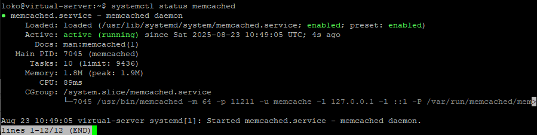
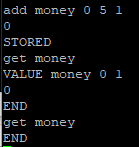
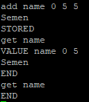

# [Задание](https://github.com/netology-code/sdb-homeworks/blob/main/11-02.md) к занятию "`Кеширование Redis/memcached`"

---

### Задание 1

Приведите примеры проблем, которые может решить кеширование. 

`Решение` Тут стоит выделить оптимизацию, т.е. снижение нигрузки на СУБД и ускорение предоставления часто используемых данных

*Приведите ответ в свободной форме.*

---

### Задание 2. Memcached

Установите и запустите memcached.

*Приведите скриншот systemctl status memcached, где будет видно, что memcached запущен.*

`Решение`

---

### Задание 3. Удаление по TTL в Memcached

Запишите в memcached несколько ключей с любыми именами и значениями, для которых выставлен TTL 5. 

*Приведите скриншот, на котором видно, что спустя 5 секунд ключи удалились из базы.*

`Решение` Установлены занчения `Semen` в name и `0` в money

 

---

### Задание 4. Запись данных в Redis

Запишите в Redis несколько ключей с любыми именами и значениями. 

*Через redis-cli достаньте все записанные ключи и значения из базы, приведите скриншот этой операции.*

`Решение` Установлены занчения `Semen` в name и `0` в money

